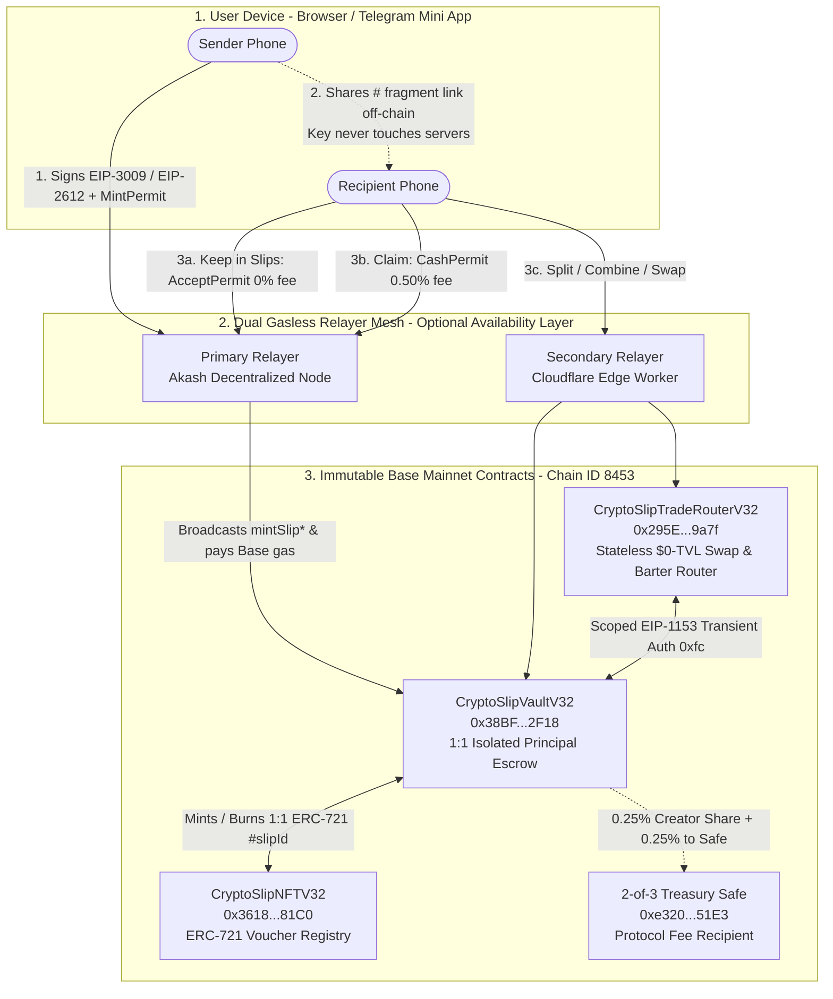

# CryptoSLIP (V3.2) — Public Overview, Architecture & Legal Defense FAQ
### *Value That Moves Like a Message.*

> **One-Sentence Summary:**  
> **CryptoSLIP** is an open, 100% non-custodial software protocol on Base Mainnet (`Chain ID 8453`) that turns digital assets (`USDC`, `cbBTC`, `ETH`, `NARA`) into a self-contained link or QR code you can send in any chat app—settling in **under 1 second** with **zero ETH gas needed**, **a 1-tap `Take back` undo button**, **automatic bill-splitting with free change**, and **personal wallet history protection**.

- **Web App (Decentralized IPFS + ENS):** [https://cryptoslip.eth.limo](https://cryptoslip.eth.limo)
- **Web3 Native ENS Domain:** `cryptoslip.eth`
- **4EVERLAND DWeb Mirror:** [https://cryptoslip-g29s.4everland.app/?v=cs-1794113891779](https://cryptoslip-g29s.4everland.app/?v=cs-1794113891779)
- **Telegram Mini App:** [https://t.me/cryptoslip_bot/SLIP](https://t.me/cryptoslip_bot/SLIP) (`@cryptoslip_bot`)
- **Network:** Base Mainnet (`Chain ID: 8453`)

---

## Table of Contents

1. [Why CryptoSLIP Exists: The Two Broken Worlds of Money](#1-why-cryptoslip-exists-the-two-broken-worlds-of-money)
2. [What CryptoSLIP Solves: The 10 Brutal Pains We Killed](#2-what-cryptoslip-solves-the-10-brutal-pains-we-killed)
3. [How It Works Under the Hood (Architecture & On-Chain Flow)](#3-how-it-works-under-the-hood-architecture--on-chain-flow)
4. [Live Mainnet Forensic Autopsy: What Is Shielded vs. What Is Auditable](#4-live-mainnet-forensic-autopsy-what-is-shielded-vs-what-is-auditable)
5. [Canonical Base Mainnet Contracts & Verifiable Proofs](#5-canonical-base-mainnet-contracts--verifiable-proofs)
6. [Transparent Fee Model & Lifetime 50/50 On-Chain Creator Fee Share](#6-transparent-fee-model--lifetime-5050-on-chain-creator-fee-share)
7. [Real-World Use Cases: How Everyday People Use It](#7-real-world-use-cases-how-everyday-people-use-it)
8. [Master Comparison: CryptoSLIP vs. Banks, MetaMask, Peanut & Umbra](#8-master-comparison-cryptoslip-vs-banks-metamask-peanut--umbra)
9. [Non-Custodial Software Architecture & Regulatory Classification Overview](#9-non-custodial-software-architecture--regulatory-classification-overview)
10. [Complete Public, User, Security & Regulatory FAQ (25 Questions Answered)](#10-complete-public-user-security--regulatory-faq-25-questions-answered)

---

## 1. Why CryptoSLIP Exists: The Two Broken Worlds of Money

Today, anyone trying to send value over the internet is trapped between two broken extremes:

```
┌────────────────────────────────────────────────────────────────────────┐
│                   THE GLOBAL PAYMENT PARADOX                           │
├──────────────────────────────────┬─────────────────────────────────────┤
│ TRADITIONAL APPS & WIRES         │ CONVENTIONAL CRYPTO                 │
│ (Venmo, Cash App, Western Union) │ (MetaMask, Standard Wallet Sends)   │
├──────────────────────────────────┼─────────────────────────────────────┤
│ ❌ Geofenced inside one country  │ ❌ Ask for a 42-char 0x address     │
│ ❌ 5%–10% cross-border wire fees │ ❌ "Insufficient ETH for gas" traps │
│ ❌ 2–5 business days for wires   │ ❌ 12-word seed phrases before use  │
│ ❌ 1.4 billion unbanked shut out │ ❌ Paying $20 exposes your net worth│
│ ❌ Accounts frozen at any time   │ ❌ 1 typo destroys money forever    │
└──────────────────────────────────┴─────────────────────────────────────┘
```

### The Traditional Financial Wall
* **Trapped Inside Borders:** You cannot Venmo or Zelle someone in another country. Domestic fintech apps only work if both sender and receiver hold bank accounts inside the same national jurisdiction.
* **The Remittance Tax:** Cross-border remittance services charge `5%` to `10%` in fees and hidden FX spreads, siphoning over `$40 billion` a year from working families while forcing recipients to wait days or visit physical kiosks.

### The Conventional Crypto Usability Trap
Sending `$20` in standard crypto still feels like defusing a bomb:
1. You have to ask the other person for their `0x` address.
2. If they don't have a wallet yet, you have to give them a 20-minute homework assignment (*"Download an extension, write down 12 words on paper, switch your network to Base..."*).
3. You have `$500 USDC` in your wallet, yet your app blocks a `$10` payment with *"Insufficient ETH for gas."*
4. You pray clipboard malware or address-poisoning bots didn't swap a character—because **one typo burns your money forever**.
5. And the second you send from `0xYourWallet` to `0xTheirWallet`, **they paste your address into a block explorer and see your entire net worth, every token you hold, and everyone you've ever paid.**

### The CryptoSLIP Solution
**CryptoSLIP turns digital value into a self-contained link or QR code.**
```
[ Sender: Anywhere on Earth ]                       [ Recipient: Any Phone or Browser ]
              │                                                    │
              ▼                                                    │
Types "$20.00 USDC"                                                │
Taps "Send" (0% Mint Fee, Zero ETH Gas)                            │
              │                                                    │
              ▼                                                    │
Drops Link in Any Chat: ─────────────────────────────────────────► Taps Link in WhatsApp / Telegram / SMS
"https://cryptoslip.eth.limo/#s142_v32_k..."                       Screen displays: "$20.00 USDC"
                                                                   Taps: [ Keep in Slips (Free) ] or [ Claim ]
                                                                           │
                                                                           ▼
                                                                   Settled on Base Mainnet in <1 second.
                                                                   Zero ETH gas needed. Zero prior setup.
```

---

## 2. What CryptoSLIP Solves: The 10 Brutal Pains We Killed

### Pain #1: Paying Someone `$20` Doxxes Your Entire Financial Life
* **The Problem:** In normal crypto, sending someone `$20` for lunch hands them your `0x` wallet address. Five seconds later, they can inspect your entire balance, your token holdings, and your full transaction history.
* **How CryptoSLIP Fixes It:**
  - You never ask for or paste a `0x` address in chat—you share an isolated **Slip** (`slipId`) backed 1:1 inside `CryptoSlipVaultV32`.
  - When a recipient taps **Keep in Slips** (`acceptWithPermit`, **`0%` fee**), the contract rotates ownership in-place to a brand-new, deterministic one-time key on their phone—**without ever touching or revealing their personal wallet address on-chain**.
  - When they later spend `$12` out of a `$50` kept slip (`splitAndPayWithPermit`) or combine small slips (`rearrangeAndPayWithPermits`), the `$38` change is minted to a fresh one-time key (`0%` fee on change). Their main wallet balance stays nobody's business but theirs.

### Pain #2: The "One Wrong Character = Money Gone Forever" Heart Attack
* **The Problem:** Normal crypto has zero mercy. Paste a poisoned address, send to the wrong chat, or pick the wrong network, and your money is gone forever.
* **How CryptoSLIP Fixes It:**
  - **1-Tap `Take back` Undo Button:** Until the recipient claims or keeps a standard slip, the sender can tap **Take back** at any time (`0%` fee from the creator's own wallet via `refundSlip`) and pull `100%` of the principal right back.
  - **12-Character Claim Codes (`Needs a code`):** Sending a larger amount or dropping a link into a group chat? Protect it with a self-contained **12-character Base58 claim code** (`XXXX-XXXX-XXXX`, derived client-side via `scrypt` + HKDF-SHA256). Even if someone intercepts the link in chat, the link carries only a cryptographic salt—nobody can claim it without the 12-character code, while the sender can still **Take back** their money anytime without needing the code. *(Note: On-chain slips never use a 4-digit PIN, because a 4-digit PIN has only 10,000 combinations and could be brute-forced by bots; a 12-character Base58 scrypt code has $58^{12}$ combinations).*

### Pain #3: "Insufficient ETH for Gas" When You Already Have Money
* **The Problem:** Having `$500 USDC` in your wallet and being told you cannot send `$5` because you lack `$0.001` of `ETH` makes crypto unusable for normal people.
* **How CryptoSLIP Fixes It:**
  - **100% Gasless Creation:** Senders create `USDC` (`>= $0.10`), `cbBTC` (`>= 1,000 sats`), and `NARA` (`>= 0.001 NARA`) slips with **zero ETH** using off-chain `EIP-3009` (`receiveWithAuthorization`) and `EIP-2612` (`permit`) paired with an `EIP-712` `MintPermit`.
  - **100% Gasless Recipient Actions:** Recipients **Keep**, **Claim**, **Split**, **Combine**, **Swap**, and **Barter** slips with **zero ETH**. Dual independent relayers broadcast the signed permit and pay the Base L2 gas.

### Pain #4: The 20-Minute Wallet Setup Homework Assignment
* **The Problem:** Telling a friend who doesn't use crypto to download an app, write down 12 seed words, and find their `0x` address kills the payment before it starts.
* **How CryptoSLIP Fixes It:**
  - **"Receive First, Set Up Later":** The value arrives in the link itself. The recipient taps the link in WhatsApp, Telegram, iMessage, or SMS, taps **Keep in Slips** (`0%` fee, `<1 second`), and the money is secured to their device immediately. No App Store download and no seed-phrase quiz before receiving money.

### Pain #5: Wallet Drainers, Fake "Connect Wallet" Popups & EIP-7702 Sweepers
* **The Problem:** Most crypto thefts happen because users sign unlimited `approve()` popups, connect their main wallet to malicious sites, or fall victim to delegated `EIP-7702` (`0xef0100`) sweeper contracts.
* **How CryptoSLIP Fixes It:**
  - **Exact-Amount Authorizations:** `USDC` (`EIP-3009`) mints grant **zero standing `approve()` allowance**—each signature authorizes only the exact amount of that single slip.
  - **Strict Contract Isolation:** `CryptoSlipVaultV32` holds 100% of active slip reserves and makes **zero external DEX calls**. The swap router (`CryptoSlipTradeRouterV32`) holds **`$0` TVL at rest** and has zero administrative privileges over the Vault.
  - **Post-Binance-Hack EIP-7702 Anti-Sweeper Defense:** Both `CryptoSlipVaultV32` and `CryptoSlipTradeRouterV32` verify 65-byte `secp256k1` `ecrecover` first, strictly reject `ERC-1271` (`0x1626ba7e`) signatures when `byte(0, signer.code) == 0xef` (preventing a malicious `0xef0100` EIP-7702 contract delegated onto a compromised EOA from forging permits without the private key), and block third-party EIP-7702 operator sweeps across all pull and NFT entry points.

### Pain #6: Having a `$50` Voucher When You Only Need to Pay `$12`
* **The Problem:** Other claim-link tools are strictly all-or-nothing: to spend `$12` from a `$50` link, you must withdraw the entire `$50` into your public wallet first.
* **How CryptoSLIP Fixes It:**
  - **Atomic Split & Pay (`splitAndPayWithPermit`):** Spend `$12` directly from a `$50` slip (`0.50%` fee charged **only** on the `$12` paid) and automatically receive a **`$38.00` change slip back at `0%` fee**.
  - **Multi-Slip Combine (`rearrangeAndPayWithPermits`):** Have three small slips (`$4 + $5 + $10 = $19`)? Combine up to `10` slips in one atomic transaction to pay a `$15` bill (`0.50%` fee on the `$15` paid) and get a **`$4.00` change slip back at `0%` fee**.

### Pain #7: Dead Zones, Bad Wi-Fi, Festivals & Flights
* **The Problem:** At a crowded festival, underground bar, or on a plane, normal crypto apps spin and fail—and if someone shows you a payment link offline, how do you know they won't cancel it before you get back online?
* **How CryptoSLIP Fixes It:**
  - **Cryptographic `No take-back` Commitment (`9_999_999_999` Recall Hold):** Choosing **`Off-grid QR`** automatically enables the permanent on-chain `No take-back` commitment paired with a 12-character claim code. Under an active recall hold, `CryptoSlipVaultV32` mathematically blocks the sender from refunding (`refundSlip` / `refundWithPermit`) or self-spending, and propagates the hold across any split, combine, or swap.
  - **Offline Local Save + `<1s` Auto-Secure on Signal:** Scanning a QR code offline saves it locally (`Saved offline · Queued`) and the exact millisecond your phone catches cellular or Wi-Fi, `reconcilePendingOps` automatically broadcasts `acceptWithPermit` (`Keep in Slips`) in the background.

### Pain #8: Ticking Expiration Timers & Lost Phones
* **The Problem:** Legacy payment links expire in 24 hours or 7 days, and losing your phone usually means losing track of unclaimed links you created.
* **How CryptoSLIP Fixes It:**
  - **Zero Expiration:** Slips in `CryptoSlipVaultV32` **never expire**. A slip created today remains 100% valid years from now until claimed, kept, or taken back.
  - **Single-Key Deterministic Recovery:** Every created slip key, kept slip hop key (`MAX_KEPT_SLIP_HOPS = 5`), split change key, and swap output key is deterministically derived (`HMAC-SHA256` / `HKDF`) from your single wallet recovery key. Restoring that **one** recovery key on a new phone (`scanVaultSlipsForWallet`) automatically finds and recovers every active slip you own.

### Pain #9: Cross-Currency Friction (`USDC` vs. `BTC` vs. `ETH` vs. `NARA`)
* **The Problem:** You hold a `USDC` slip, but you want `cbBTC` (Bitcoin), `ETH`, or `NARA`—or a merchant wants to be paid in a different asset.
* **How CryptoSLIP Fixes It:**
  - **In-Vault Slip-to-Slip Swaps & P2P Barter (`CryptoSlipTradeRouterV32`):** Swap a slip from one asset into another (`swapSlipToSlip`, `swapCompositeSlipToSlip`), pay a merchant in a different asset (`swapAndPayWithPermit`), or atomically barter two slips peer-to-peer (`tradeSlipsWithPermits`)—all while keeping the output in a fresh slip without exposing your main wallet.

### Pain #10: Centralized Server Kill-Switches
* **The Problem:** Most Web3 apps break if their company server goes down or if a relayer censors a user.
* **How CryptoSLIP Fixes It:**
  - **Decentralized Hosting:** Served from **IPFS + ENS (`cryptoslip.eth.limo`)** and **4EVERLAND**.
  - **Dual Independent Relayers + 6-Endpoint Base RPC Mesh:** Automatic failover between an independent **Akash Network node** and a **Cloudflare Edge Worker**, backed by 6 Base RPC providers.
  - **Open Permits (`relayer = address(0)`):** Every user permit is signed with `relayer = address(0)`. Even if every CryptoSLIP server disappeared tomorrow, any wallet with Base ETH can submit the exact same signed permit directly to `CryptoSlipVaultV32` on Base Mainnet.

---

## 3. How It Works Under the Hood (Architecture & On-Chain Flow)



### The Three Architectural Pillars

1. **The URL `#` Fragment Shield (RFC 3986):**
   - When a sender creates a slip, their device generates a 256-bit `secp256k1` ephemeral claim key (or derives one from a 12-character `scrypt` claim code).
   - Only the **public address** (`claimSigner`) is stored on-chain in `CryptoSlipVaultV32`.
   - The **private key** (`_k<64-hex>`) or salt (`_z<32-hex>`) is placed strictly inside the **URL `#` hash fragment** (`https://cryptoslip.eth.limo/#s142_v32_k...`).
   - Under internet standard **RFC 3986**, browsers **never transmit the `#` fragment in HTTP requests**. Neither web servers, nor CDNs, nor relayers ever see the link's secret key. Furthermore, on app boot, `clearLinkFromUrl()` scrubs the `#` fragment from the browser address bar in `< 1 millisecond`.

2. **Strict Separation of `creator` vs. `refundBeneficiary`:**
   - Every slip tracks two distinct roles on-chain:
     - `slips[slipId].creator`: Preserves the original human sender solely to enforce active `No take-back` recall holds and first-touch creator fee-share attribution (`referrerOf`).
     - `refundBeneficiary[slipId]`: Tracks who owns the economic recall right.
   - The moment a recipient taps **Keep in Slips** (`acceptWithPermit`), or splits, combines, or swaps a slip, `refundBeneficiary` and `claimSigner` atomically rotate to the recipient's fresh deterministic key. The original sender can **never** recall or touch the slip again.

3. **5 Disjoint On-Chain Liability Buckets (`INV-SOLV-01`):**
   - `CryptoSlipVaultV32` tracks every wei/sat/micro-unit across five strictly separated state buckets per asset $A$:
     $$\text{balance}(A) \ge \text{liabilities}(A) = \text{totalPrincipal}[A] + \text{accruedFees}[A] + \text{totalRefundCredits}[A] + \text{totalReferralCredits}[A] + \text{bountyObligations}(A)$$
   - No function in the contract can ever touch `totalPrincipal`, `totalReferralCredits`, `totalRefundCredits`, or `bountyObligations` except a valid permit or call from the rightful holder.

---

## 4. Live Mainnet Forensic Autopsy: What Is Shielded vs. What Is Auditable

CryptoSLIP is designed for **legitimate personal financial privacy** (not exposing your net worth to every coffee shop, freelancer, or group chat) while remaining **100% compliant and auditable** (never a commingled mixer).

Here is what happens on-chain on Base Mainnet (`8453`) across a slip's lifecycle:

| Stage | What Happens | What the Counterparty / Public Sees | What Remains 100% Shielded |
| :--- | :--- | :--- | :--- |
| **1. Sender Creates Slip** | Sender signs gasless `MintPermit` + `EIP-3009`. Relayer broadcasts `mintSlipWithAuthorization`. | `Sender -> CryptoSlipVaultV32` for exact slip amount; `claimSigner = 0xEphemeralKey1`. | **Recipient's identity & wallet address are 100% invisible** (not on-chain). |
| **2. Recipient Taps `Keep in Slips` (`0%` Fee)** | Recipient signs `AcceptPermit` (`keepEscrowedInVault: true`) rotating key to `0xEphemeralKey2`. | `SlipAccepted` on `slipId` with `newClaimSigner = 0xEphemeralKey2` (an empty 1-time address). | **Recipient's personal wallet address (`userAddress`) does NOT appear anywhere in the transaction.** |
| **3. Recipient Splits or Combines Slips** | Recipient pays `$12` from a `$50` kept slip (`splitAndPayWithPermit`). | Merchant receives `$11.94`; `$38.00` change slip is minted to `0xEphemeralKey3`. | **Merchant never sees the payer's personal wallet address, net worth, or past trades.** |
| **4. Deep Contract Event Lineage** | Every `slipId` is an isolated 1:1 struct (`SlipData`). | Publicly verifiable 1:1 event chain (`SlipMinted` -> `SlipAccepted` -> `SlipSplit` / `SlipCashed`). | **Zero commingling.** Unlike Tornado Cash, funds are never pooled into an anonymity mixer. |

### 4.1 Three-Tier On-Chain Visibility Analysis (Market Scanners vs. Manual Forensics vs. `mintSlipFor`)

Because `CryptoSlipVaultV32` (`0x38BF0321FA7489576978353a6a8da4A3e85C2F18`) isolates every voucher inside its internal `slips[slipId]` mapping and executes recipient actions via gasless relayers, on-chain visibility breaks down into three distinct tiers:

* **Tier 1 — Automated Market Scanners, Copy-Trade Bots & Cluster Visualizers (`99%` of Market Participants: DEX Screener, Bubblemaps, Photon, BullX, GMGN):**
  - **Linkage Visibility:** **`0%` (Difficulty `10 / 10` — Completely Invisible to Automated Heuristics).**
  - **Why:** When a trader, copy-trade bot, or cluster scanner inspects a recipient wallet that claimed a Slip (`cashWithPermit`), the wallet's top-level `Transactions` tab shows **`0` direct EOA-to-EOA transfers** from the sender. Under `Internal Txns` (for `ETH`) or `ERC-20 Token Txns` (for `USDC` / `cbBTC` / `NARA`), the funds arrive strictly from `CryptoSlipVaultV32` (`0x38BF0321FA7489576978353a6a8da4A3e85C2F18`) inside a transaction whose `From` address is an independent gasless Relayer and whose `To` address is `CryptoSlipVaultV32`. Automated cluster graphs and copy-trading indexers do not decompile internal `slips[slipId]` contract storage or correlate multi-block event topics, so the recipient wallet appears as a clean, unlinked address.

* **Tier 2 — Manual Block-Explorer Investigator ("BaseScan Detective" Tracing Transactions by Hand):**
  - **Tracing Complexity:** **High (`8.5 / 10` — Requires a 6-Step Hexadecimal Event-Log Trace Across Blocks).**
  - **What a Manual Investigator Must Do to Trace a Claimed Slip:**
    1. Open the recipient wallet on BaseScan and observe `0` direct incoming transactions from the sender in the main `Transactions` list.
    2. Switch to `Internal Txns` or `ERC-20 Token Txns` and locate the `cashWithPermit` settlement transaction from `CryptoSlipVaultV32` (`0x38BF...2F18`).
    3. Open that transaction's overview page—which displays only `From: Relayer` and `To: CryptoSlipVaultV32` (neither the sender's wallet nor any intermediate wallet appears in the transaction header).
    4. Navigate to the raw **`Logs`** tab of that transaction, find the `SlipCashed` event emitted by `0x38BF...2F18`, and manually decode the 32-byte hexadecimal `topic[1]` (`indexed uint256 slipId`) into a decimal `slipId`.
    5. Write a custom RPC script or manually filter historical blocks on `0x38BF...2F18` for the `SlipMinted` event matching that exact 32-byte hex `topic[1] = bytes32(slipId)`.
    6. Inspect the originating `SlipMinted` transaction (and recursively repeat the entire hex `topic[1]` decoding cycle across every parent `slipId` if the voucher was previously split, combined, swapped, or funded from an earlier Slip).

* **Tier 3 — Delegated `mintSlipFor` Mode vs. Standard Consumer `mintSlip*` Mode (`CryptoSlipProtocolV32.sol` Line `448`):**
  - **`mintSlipFor` Is Natively Built Into Live `CryptoSlipVaultV32`:** Line `448` of `CryptoSlipProtocolV32.sol` implements `mintSlipFor(token, amount, creator, claimSigner, referrer, cancelLockedUntil, escrowInVault)`, which allows a caller or router to specify an explicit `creator` address separate from `msg.sender`. When invoked with a one-time ephemeral address (`creator = claimSigner = ephemeralAddress`), even `topic[2]` (`indexed address creator`) inside the `SlipMinted` event log records a unique one-time address rather than a recurring wallet—preventing bulk log filtering by `topic[2]`.
  - **Why the Public Consumer App Uses `creator = userAddress` While Router / Programmatic Flows Use `mintSlipFor`:**
    1. **Cross-Device & Lost-Phone Slip Recovery (`onChainService.ts`):** If a retail user creates a Slip and later loses their phone, clears browser `localStorage`, or signs in on a new device, the CryptoSLIP web app scans `SlipMinted(null, userAddress)` (`topic[2]`) on Base Mainnet to automatically discover and restore every active Slip they created. Setting `creator` to a random one-time address in the standard consumer UI would prevent `topic[2]` wallet-based Slip discovery after a browser reset.
    2. **Free `0%` "Take Back" Undo (`CryptoSlipProtocolV32.sol` Line `1563`):** The Vault contract enforces `if (creator == claimSigner) { refundFeeRequired[slipId] = true; }` at line `1563`. When an everyday user creates a Slip with `creator = userAddress` (`creator != claimSigner`), they can tap **Take back** (`refundSlip`) from their wallet at any time before the Slip is kept and recover **`100%` of their principal at `0%` fee**. By contrast, when `mintSlipFor` is called with `creator == claimSigner`, the contract sets `refundFeeRequired[slipId] = true`, applying the `0.50%` protocol fee on any refund.
    3. **Gasless `USDC` Creation (`EIP-3009 receiveWithAuthorization`):** When a consumer mints a `USDC` Slip without paying `ETH` gas (`mintSlipERC20WithAuthorization`), Circle's official `USDC` contract requires the `EIP-3009` signature authorizer (`creator`) to match the address from which `USDC` is pulled.

### 4.2 Living "Inside Slips" (`Keep in Slips` + `swapSlipToSlip`) & the UTXO `slipId` Serial-Number Genealogy (`CryptoSlipProtocolV32.sol` Lines `1862–1885`)

What happens if a user moves funds into Slips and conducts their entire financial life inside the Vault—receiving Slips via Telegram or Signal, tapping **Keep in Slips** (`acceptWithPermit`), and buying or selling `NARA`, `ETH`, `cbBTC`, or `USDC` via **`CryptoSlipTradeRouterV32` (`0x295E72cB3dc09582F32e0fEB7e0e650752219a7f`)** (`swapSlipToSlip`)?

CryptoSLIP V3.2 solves this using a **Digital Banknote with Serial Numbers (UTXO) Architecture** that delivers **100% personal identity privacy for honest users** while maintaining **100% fund-provenance transparency against hackers**:

1. **Why an Honest User Living "Inside Slips" Is 100% Invisible to Counterparties & Market Scanners:**
   - Once a user holds a Slip (or taps **Keep in Slips** on a link received from a friend), their personal wallet (`MetaMask`, `Coinbase Wallet`, `Rabby`) **never participates in any subsequent transaction**.
   - Every Slip is controlled solely by a device-local one-time key (`claimSigner`), and every on-chain transaction is broadcast by a gasless Relayer.
   - When the user buys or sells `NARA`, `ETH`, `cbBTC`, or `USDC` inside Slips via `swapSlipToSlip`, DEX Screener and pool trackers see **only `CryptoSlipTradeRouterV32` (`0x295E...9a7f`)** executing the swap, and the purchased tokens return immediately into `CryptoSlipVaultV32` (`0x38BF...2F18`) as a brand-new voucher (`outputSlipId`).
   - Nobody on earth can see whose phone currently holds `outputSlipId`. A user can receive a Slip link on Telegram, tap **Keep in Slips**, swap it into `NARA` inside the Vault, and send the new Slip link to a third person—and **not a single personal wallet address of any participant ever appears on-chain**.

2. **How Illicit Actors & Stolen Funds Are Tracked (`slipId` Serial-Number Genealogy at Lines `1862–1885`):**
   - Look at `CryptoSlipProtocolV32.sol` lines `1862–1885` (paired with Vault split/rearrange events): every single in-vault operation emits an immutable **serial-number genealogy link** connecting the input `slipId` to the resulting output `slipId`s:
     - `SlipSwappedToSlip(inputSlipId, changeSlipId, outputSlipId, ...)`
     - `SlipSwappedAndPaid(inputSlipId, changeSlipId, merchant, ...)`
     - `SlipsTradedP2P(slipIdA, slipIdB, newSlipForA, newSlipForB, ...)`
     - `SlipSplit(originalSlipId, paidAmount, feeCharged, changeSlipId, merchant)`
     - `SlipsRearranged(inputSlipIds, totalInput, paidAmount, feeCharged, changeSlipId, recipient)`
   - **What This Means:**
     - **Holder Identity (whose phone holds the Slip right now) is `100%` private**, because vouchers move off-chain as `#` fragment links controlled by ephemeral keys.
     - **Fund Provenance (the serial-number chain `Slip #100 -> Slip #105 -> Slip #118 -> Slip #150`) is `100%` transparent and unbroken!**
   - If a hacker steals `$100,000 USDC` from an external protocol and deposits it into `Slip #100`, even if they swap and split that voucher 50 times inside Slips (`USDC -> ETH -> NARA -> cbBTC -> USDC`), the serial-number lineage (`#100 -> #105 -> #118 -> ... -> #150`) never breaks—functioning exactly like Bitcoin UTXOs or physical banknotes with serial numbers. The moment the attacker attempts to cash out the final `Slip #150` to an exchange deposit address (such as Binance or Coinbase), compliance tools trace `Slip #150` directly back to the tainted origin `Slip #100`.
   - **The Result:** Honest users and traders enjoy **100% personal wallet and trade privacy inside Slips**, while hackers **cannot launder stolen funds** because every voucher inherits the unbroken `slipId` provenance tree of its parent. This is why regulators, exchanges, and stablecoin issuers (such as Circle) recognize the UTXO serial-number escrow model as completely clean and non-commingled.

---

## 5. Canonical Base Mainnet Contracts & Verifiable Proofs

All CryptoSLIP V3.2 smart contracts are deployed live on **Base Mainnet (`Chain ID: 8453`, Block `53289788`)**, verified `exact_match` on Sourcify, and owned by the **2-of-3 Gnosis Safe (`0xe320C281c86079eA85f2Bc67864E873A61D551E3`)**:

| Contract | Base Mainnet Address (`8453`) | Bytecode Size | Verification & Role |
| :--- | :--- | :---: | :--- |
| **`CryptoSlipVaultV32`** | [`0x38BF0321FA7489576978353a6a8da4A3e85C2F18`](https://basescan.org/address/0x38BF0321FA7489576978353a6a8da4A3e85C2F18) | `24,201 B` | [Sourcify Exact Match (`57685358`)](https://repo.sourcify.dev/8453/0x38BF0321FA7489576978353a6a8da4A3e85C2F18) — Core 1:1 non-custodial escrow vault (`ISSUE_VAULT = 'v32'`). |
| **`CryptoSlipNFTV32`** | [`0x36181Ca1B0210b6Ea8E56755dA7B06c34ba481C0`](https://basescan.org/address/0x36181Ca1B0210b6Ea8E56755dA7B06c34ba481C0) | `5,669 B` | [Sourcify Exact Match (`57685325`)](https://repo.sourcify.dev/8453/0x36181Ca1B0210b6Ea8E56755dA7B06c34ba481C0) — Paired ERC-721 + EIP-2981 (`0.50%`) voucher contract. |
| **`CryptoSlipTradeRouterV32`** | [`0x295E72cB3dc09582F32e0fEB7e0e650752219a7f`](https://basescan.org/address/0x295E72cB3dc09582F32e0fEB7e0e650752219a7f) | `17,258 B` | [Sourcify Exact Match (`57685333`)](https://repo.sourcify.dev/8453/0x295E72cB3dc09582F32e0fEB7e0e650752219a7f) — Stateless `$0`-TVL Slip-to-Slip DEX swap & P2P barter router. |
| **`Treasury Safe` (2-of-3)** | [`0xe320C281c86079eA85f2Bc67864E873A61D551E3`](https://basescan.org/address/0xe320C281c86079eA85f2Bc67864E873A61D551E3) | Safe v1.4.1 | 2-of-3 Multi-Sig Owner (`pendingOwner() == address(0)`). |
| **`CryptoSlipVaultCoreV3`** | [`0x4Dc2b5A801A81b17b8d05C737c727FEd1f30699A`](https://basescan.org/address/0x4Dc2b5A801A81b17b8d05C737c727FEd1f30699A) | Live V3 | Historical V3 reference vault (remains on-chain forever for V3 links). |
| **`CryptoSlipVaultCore` (V2)**| [`0x87aadDF2d3aa11Cddf36939715508066a99BA415`](https://basescan.org/address/0x87aadDF2d3aa11Cddf36939715508066a99BA415) | Legacy V2 | Legacy V2 vault (paused for new mints; claims & refunds open forever). |

### Allowlisted Base Mainnet Assets (`CryptoSlipVaultV32`)

| Asset | Symbol | Base Mainnet Address | Decimals | Minimum Slip Amount | Creator Fee-Share Minimum |
| :--- | :---: | :--- | :---: | :---: | :---: |
| **USD Coin** | `USDC` | `0x833589fCD6eDb6E08f4c7C32D4f71b54bdA02913` | `6` | `$0.10 USDC` (`1e5`) | `$0.10 USDC` (`1e5`) |
| **Coinbase Wrapped BTC** | `cbBTC` | `0xcbB7C0000aB88B473b1f5aFd9ef808440eed33Bf` | `8` | `1,000 sats` (`1e3`) | `100 sats` (`1e2`) |
| **Native Ether** | `ETH` | `0x0000000000000000000000000000000000000000` | `18` | `0.0001 ETH` (`1e14` wei) | `0.0001 ETH` (`1e14` wei) |
| **NARA Token V5** | `NARA` | `0x91FB78A9F46B67f54BbD4489941d19666b2fAe0f` | `18` | `0.001 NARA` (`1e15` wei) | `0.001 NARA` (`1e15` wei) |

---

## 6. Transparent Fee Model & Lifetime 50/50 On-Chain Creator Fee Share

CryptoSLIP has **zero subscription fees, zero monthly fees, zero markup on change slips, and zero hidden charges**.

### Complete Fee Schedule (`FEE_BPS = 50` / `0.50%` Ceiling Rounding)
$$\text{fee}(\text{grossAmount}) = \left\lceil \frac{\text{grossAmount} \times 50}{10,000} \right\rceil = \frac{\text{grossAmount} \times 50 + 9999}{10,000}$$

| Action | On-Chain Function | Protocol Fee | Who Receives the Fee? |
| :--- | :--- | :---: | :--- |
| **Create a Slip (Mint)** | `mintSlip*` | **`0%` (Free)** | — |
| **Keep in Slips (1st Recipient Keep)** | `acceptWithPermit` (`nonces == 0`) | **`0%` (Free)** | — |
| **Take Back (Creator Own-Wallet, Un-Kept)** | `refundSlip` (`msg.sender == creator`) | **`0%` (Free)** | — |
| **Change Slip Minted During Split / Combine** | `_mintChangeSlip` | **`0%` (Free)** | — |
| **Claim to Wallet** | `cashWithPermit` | **`0.50%`** | `0.25%` Protocol + `0.25%` Inviting Creator (or `0.50%` Protocol if uninvited) |
| **Split & Pay (On Paid Portion Only)** | `splitAndPayWithPermit` | **`0.50%`** on `paymentAmount` | `0.25%` Protocol + `0.25%` Inviting Creator |
| **Combine & Pay (On Paid Portion Only)** | `rearrangeAndPayWithPermits` (`paymentAmount > 0`) | **`0.50%`** on `paymentAmount` | `0.25%` Protocol + `0.25%` Inviting Creator |
| **Consolidate Slips (`paymentAmount == 0`)** | `rearrangeAndPayWithPermits` | **`0.50%`** on `totalInput` | `0.25%` Protocol + `0.25%` Inviting Creator |
| **2nd+ Re-Transfer Keep or NFT Transfer** | `acceptWithPermit` / `onNFTTransfer` | **`0.50%`** | `0.25%` Protocol + `0.25%` Inviting Creator |
| **Relayed / Post-Keep / Redirected Refund** | `refundWithPermit` | **`0.50%`** | `100%` to Protocol (`0` to Inviting Creator to prevent refund-loop farming) |
| **Slip-to-Slip Swap or P2P Barter** | `CryptoSlipTradeRouterV32` | **`0.50%`** on swapped input | `0.25%` Protocol + `0.25%` Inviting Creator |
| **Convert Creator Fee Credits into a New Slip** | `claimReferralAsSlip` | **`0%` (Free)** | — |

### How the Lifetime `50/50` On-Chain Creator Fee Share Works
Every slip you send is automatically your invite link:
1. **Pure First-Touch Binding (`referrerOf`):** When a new user claims (`cashWithPermit`) or keeps (`acceptWithPermit`) a human-created slip you sent them (at or above `$0.10 USDC`, `100 sats cbBTC`, `0.0001 ETH`, or `0.001 NARA`), `CryptoSlipVaultV32` permanently records `referrerOf[recipient] = creator` on-chain **for life** (first-touch wins, never overwritten).
2. **Automatic `50/50` Revenue Split:** Forever after, whenever that user creates slips that settle with a `0.50%` fee, **half of the protocol fee (`0.25%` of total payment volume)** is credited directly on-chain to your creator fee-share balance (`[yourAddress][asset]`).
3. **Paid Out of Protocol Share (Zero Extra Cost to Users):** Invited users pay the exact same `0.50%` settlement fee as everyone else; the `0.25%` share comes strictly out of the protocol's half.
4. **Instant On-Chain Withdrawal or Free Slip Creation:** Withdraw your accumulated `USDC`, `cbBTC`, `ETH`, or `NARA` creator fee credits anytime or turn them directly into a spendable slip at **`0%` fee**.

---

## 7. Real-World Use Cases: How Everyday People Use It

1. **Zero-Fee Remittances to Family Overseas:**
   - Send `$50 USDC` to family in Manila, Bogotá, or Lagos by dropping a link into WhatsApp. Instead of losing `10%` (`$5+`) to Western Union and waiting 3 days, it arrives in `< 1 second` and costs `$0.00` to keep on their phone or `$0.25` (`0.50%`) to cash out to a wallet.
2. **Splitting Dinner or Group Tabs in Telegram / Signal / iMessage:**
   - Drop a `$20` slip link into the group chat. No asking *"What's your IBAN / Venmo / Revolut / `0x` address?"*
3. **Paying Global Freelancers & Creators Privately:**
   - Pay a designer or developer `$500 USDC` via a code-protected slip (`Needs a code`) without exposing your company treasury or personal wallet balance to them.
4. **In-Person Coffee Shops, Markets & Bodegas ("Split & Pay"):**
   - Hold a `$50 USDC` slip on your phone, scan a merchant's QR code to pay `$3.50`, and get `$46.50` back as a fresh change slip in `< 1 second` (`0%` fee on change)—even in poor reception using `Off-grid QR`.
5. **Harvesting NARA V5 15-Minute Pulse Rewards Straight into Spendable Slips:**
   - NARA V5 Grid participants (`NARARewardLedgerV5` `0xC72671D9438388638547444524F6542b650C9264`) can claim their accrued `USDC`, `ETH`, or `NARA` 15-minute pulse rewards directly into shareable CryptoSLIP vouchers (`harvestNaraRewardsOnChain`) without selling a single token of their committed principal.

---

## 8. Master Comparison: CryptoSLIP vs. Banks, MetaMask, Peanut & Umbra

| Feature | Venmo / Cash App | Western Union | Standard Wallet (MetaMask) | Peanut Protocol | Umbra (Stealth) | **CryptoSLIP V3.2** |
| :--- | :---: | :---: | :---: | :---: | :---: | :---: |
| **Borderless Global Reach** | ❌ Single country | ✅ Global | ✅ Global | ✅ Global | ✅ Global | ✅ **Global (Any Chat / Browser)** |
| **Settlement Speed** | 1–3 business days | 1–3 business days | 2–15 seconds | ~2–5 seconds | ~2–15 seconds | ⚡ **< 1 Second (Base L2)** |
| **Fee** | Free / 1.5% instant | 🔴 5% – 10% | Network gas | Gasless / router | Network gas | 🟢 **`0%` Mint & Keep / `0.50%` Claim & Pay** |
| **Zero ETH Gas for Recipient** | N/A | N/A | ❌ Must hold ETH | ✅ Yes | Optional | ✅ **`$0.00` ETH (Dual Relayer + Open Fallback)** |
| **Zero Recipient Pre-Setup** | ❌ Both need app/bank | ❌ ID at kiosk | ❌ Must set up wallet | ✅ Yes | ❌ Must register keys | ✅ **Yes (Tap link -> Keep in 1s)** |
| **1-Tap Sender Undo (`Take back`)**| ❌ Hard to reverse | ❌ Irreversible | 💀 **Gone forever** | ✅ Cancel link | ❌ Irreversible | 🛡️ **1-Tap `Take back` (`0%` Fee Direct)** |
| **Shields Personal Wallet History**| N/A (Custodial) | N/A | ❌ Exposes `0x` wallet | ❌ Claim exposes wallet | ⚠️ Sweep links CEX | 🛡️ **Yes (`Keep in Slips` + Ephemeral Keys)** |
| **Atomic Partial Spend & Change** | N/A | ❌ No | ❌ Manual full send | ❌ All-or-nothing | ❌ No | ✅ **`splitAndPayWithPermit` (`0%` Fee Change)** |
| **Combine Multiple Vouchers** | N/A | ❌ No | ❌ Manual | ❌ No | ❌ No | ✅ **`rearrangeAndPayWithPermits` (Up to 10)** |
| **In-Vault Swaps & P2P Barter** | ❌ No | ❌ No | Exposes wallet | ❌ No | ❌ No | ✅ **`CryptoSlipTradeRouterV32`** |
| **Off-Grid `No take-back` Hold** | ❌ No | ❌ No | ❌ No | ❌ Sender can cancel | N/A | ✅ **Permanent Recall Hold + 12-Char Code** |
| **Lifetime On-Chain Fee Share** | One-time promo | One-time promo | ❌ None | ❌ None | ❌ None | ✅ **`50/50` Fee Split (`0.25%` Forever)** |
| **Custody Model** | 🔴 Custodial | 🔴 Custodial | 🟢 Non-custodial | 🟢 Non-custodial | 🟢 Non-custodial | 🛡️ **100% Non-Custodial 1:1 Smart Contract** |

---

## 9. Non-Custodial Software Architecture & Regulatory Classification Overview

CryptoSLIP is engineered from the ground up as **autonomous, non-custodial software**. Below is an architectural overview of how its non-custodial design maps to published US, EU, and international regulatory guidance (provided for technical and informational orientation, not formal legal advice):

### 9.1 Core Legal Classification
1. **NOT A BANK (`12 U.S.C. § 1813`):**
   - CryptoSLIP does not accept customer deposits onto a corporate balance sheet, does not make loans, does not pay interest or yield on vault principal, and never engages in fractional-reserve banking. Every active slip is backed `100%` `1:1` by the exact asset escrowed in `CryptoSlipVaultV32`.
2. **NOT A MONEY TRANSMITTER / MSB (`FinCEN Guidance FIN-2019-G001 § 5.2.1`):**
   - Under US Federal Law (`31 CFR § 1010.100(ff)(5)` and FinCEN's 2019 CVC Guidance § 5.2.1), software providers and non-custodial smart contract publishers are **not Money Services Businesses (MSBs)** unless they exercise **"total independent control"** over customer value.
   - Because `CryptoSlipVaultV32` has **no admin withdrawal function, no upgrade proxy, and no `pause()` function**, neither the developers, nor the relayers, nor the 2-of-3 Treasury Safe can ever move, freeze, redirect, or seize user principal. Only the holder of the slip's cryptographic key controls the funds.
3. **NOT A CASP UNDER EU MiCA (`MiCA Regulation (EU) 2023/1114 Recital 22`):**
   - Recital 22 of the European Union Markets in Crypto-Assets (MiCA) Regulation explicitly exempts crypto-asset services provided in a **fully decentralized manner without any intermediary**.
4. **CONTROLLABLE ELECTRONIC RECORD / NEGOTIABLE VOUCHER (`UCC Article 12 & § 3-104`):**
   - Each slip functions as a 1:1 asset-backed controllable electronic record (`SlipData` + `CryptoSlipNFTV32`) whose control is transferred via cryptographic signature (`secp256k1` EIP-712 permits).

---

### 9.2 Why CryptoSLIP Is NOT a Mixer (CryptoSLIP V3.2 vs. Tornado Cash)

A common question from compliance teams is how CryptoSLIP's wallet shielding differs from sanctioned anonymizing mixers like Tornado Cash. The architectural difference is absolute:

| Compliance Dimension | Tornado Cash (Sanctioned Mixer) | CryptoSLIP V3.2 (`0x38BF...2F18`) |
| :--- | :--- | :--- |
| **Commingling of Funds** | **Commingled Pools:** Mixes thousands of unrelated deposits into shared fixed-size pools (`0.1`, `1`, `10`, `100 ETH`). | **Zero Commingling:** Every `slipId` is an isolated, exact-amount `1:1` `SlipData` struct and ERC-721 voucher (`CryptoSlipNFTV32`). |
| **On-Chain Provenance** | **Severed Provenance:** Uses Zero-Knowledge SNARKs to break the cryptographic link between deposit and withdrawal. | **1:1 Deterministic Provenance:** Every `slipId` emits public on-chain events (`SlipMinted` -> `SlipAccepted` -> `SlipSplit` / `SlipCashed` / `SlipRefunded`) on Base Mainnet. |
| **Purpose of Privacy** | Pool-based obfuscation of illicit fund trails. | **Commercial Counterparty Shielding:** Prevents a merchant or chat contact from scraping the payer's personal wallet net worth when paid `$20`, while keeping the 1:1 voucher lifecycle auditable on Base. |
| **Sanctions & Blacklist Enforcement** | Ignored token-level OFAC blacklists. | **Inherits Circle `USDC` & Coinbase `cbBTC` Blacklists:** Directly uses official `USDC` (`0x8335...2913`) and `cbBTC` (`0xcbB7...33Bf`) contracts on Base, which block sanctioned addresses at the ERC-20 transfer layer. |

---

### 9.3 Complete Register of Admin Powers (What the 2-of-3 Safe Can & Cannot Do)

All three V3.2 contracts are owned by the **2-of-3 Gnosis Safe (`0xe320C281c86079eA85f2Bc67864E873A61D551E3`)**. Its powers are strictly bounded in immutable bytecode:

| What the 2-of-3 Treasury Safe **CAN** Do | What the 2-of-3 Treasury Safe **CANNOT** Do (Mathematically Impossible) |
| :--- | :--- |
| **Add** a new ERC-20 token (`decimals <= 18`) to the Vault allowlist (`setTokenAllowed(token, true)`). | **Cannot** remove or delist an already-allowlisted token (`DisallowingTokenForbidden()`). |
| **Update** the cosmetic NFT metadata prefix (`setBaseURI`). | **Cannot** pause, freeze, or block any mint, claim, keep, split, combine, swap, or refund (`zero pause()` functions in V3.2). |
| **Add or revoke** an external DEX aggregator target on `CryptoSlipTradeRouterV32` (`setRouterAllowed`). | **Cannot** withdraw, seize, redirect, or touch a single wei of user principal (`totalPrincipal`), creator fee credits, refund credits, or bounties. |
| **Receive** accrued `0.25%–0.50%` protocol fees (`withdrawFees` transfers strictly to `immutable treasurySafe`). | **Cannot** upgrade or replace the contract bytecode (zero proxy pattern) or raise `FEE_BPS` above `50` (`0.50%`). |

---

## 10. Complete Public, User, Security & Regulatory FAQ (25 Questions Answered)

### Part A: General & User Questions

#### 1. What is a Crypto Slip?
A Crypto Slip is a 1:1 asset-backed digital voucher (`USDC`, `cbBTC`, `ETH`, or `NARA`) held in the immutable `CryptoSlipVaultV32` smart contract on Base Mainnet (`8453`). You can share it as a link in any messaging app or as a QR code in person.

#### 2. Does the recipient need an existing crypto wallet or app to receive money?
**No.** The recipient simply taps the link in WhatsApp, Telegram, Signal, iMessage, or SMS. It opens instantly in their mobile browser or Telegram Mini App, initializes a non-custodial key locally on their device, and lets them **Keep in Slips** (`0%` fee) or **Claim** in `< 1 second`.

#### 3. Does the sender or recipient need `ETH` to pay blockchain gas fees?
**No.** Creating `USDC` (`>= $0.10`), `cbBTC` (`>= 1,000 sats`), or `NARA` (`>= 0.001 NARA`) slips—and keeping, claiming, splitting, combining, or swapping slips—is **100% gasless**. Dual independent relayers pay the Base L2 gas on the user's behalf.

#### 4. What is the difference between "Keep in Slips" and "Claim to Wallet"?
- **Keep in Slips (`0%` fee, Free):** Rotates the slip's cryptographic key on-chain (`acceptWithPermit`) to a fresh one-time key controlled exclusively by your phone. The sender can **no longer take it back**, your personal wallet address is **never exposed on-chain**, and you can later spend pieces of the slip (`Split & Pay`), combine it with other slips, or swap it inside the Vault.
- **Claim to Wallet (`0.50%` fee):** Withdraws the underlying `USDC`, `cbBTC`, `ETH`, or `NARA` out of the Vault directly into your wallet balance (`cashWithPermit`).

#### 5. What happens if I send a link to the wrong person or wrong group chat?
As long as the slip has not yet been claimed or kept (and wasn't created with the `No take-back` commitment), you simply tap **Take back** in your `Slips` tab (`0%` fee from your own wallet). `100%` of your funds return to your wallet in `< 1 second`, and the shared link becomes dead.

#### 6. How do I protect a high-value link in a group chat or public place?
When creating the slip, open **Link options** and choose **Needs a code**. The app generates a **12-character claim code** (`XXXX-XXXX-XXXX`). The link itself only carries a random cryptographic salt, so anyone who clicks the link without the 12-character code cannot touch the funds—and you can still **Take back** your slip anytime without needing the code.

#### 7. Do Crypto Slips ever expire?
**Never.** Slips have zero expiration dates and zero countdown timers. An unclaimed slip from a year ago is still 100% valid today until claimed, kept, or taken back by the sender.

#### 8. What if I have a `$50` slip, but I only want to pay someone `$12`?
You don't need to withdraw the `$50` to your wallet. Using **Split & Pay** (`splitAndPayWithPermit`), you pay `$12` directly from the `$50` slip (`0.50%` fee charged only on the `$12` paid) and automatically get a **`$38.00` change slip back with `0%` fee**.

#### 9. What if I have several small slips (`$4`, `$5`, `$10`) and want to pay a `$15` bill?
CryptoSLIP automatically combines up to `10` active slips of the same asset in a single tap (`rearrangeAndPayWithPermits`), pays the `$15` (`0.50%` fee on `$15`), and returns a **`$4.00` change slip at `0%` fee**.

#### 10. How does CryptoSLIP work offline (at festivals, on planes, or in bad reception)?
When creating a slip for in-person use, select **Off-grid QR**. This automatically seals creator recall on-chain (`No take-back`, permanent hold `9_999_999_999`) and pairs the QR with a 12-character claim code. When the recipient scans the QR offline, their phone saves it locally (`Saved offline · Queued`) and automatically secures it on-chain via `acceptWithPermit` the exact second their phone regains a single bar of signal.

---

### Part B: Security, Self-Custody & Decentralization Questions

#### 11. Can the CryptoSLIP team, relayers, or Treasury Safe steal, freeze, or pause my funds?
**No—it is mathematically impossible.** `CryptoSlipVaultV32` (`0x38BF0321FA7489576978353a6a8da4A3e85C2F18`) is immutable, non-upgradeable bytecode with **zero `pause()` function** and **zero admin withdrawal functions** over user principal.

#### 12. Can a relayer change the recipient address of my claim or steal my slip?
**No.** The relayer never sees your slip's private key. Your phone signs an `EIP-712` typed-data permit locally that cryptographically binds the `slipId`, `recipient`, `amount`, `nonce`, and `deadline`. If a relayer alters even a single bit, `CryptoSlipVaultV32` rejects the transaction with `InvalidSignature()`.

#### 13. What happens if CryptoSLIP's website and relayer servers all go offline at the same time?
1. **Frontend:** The app lives on decentralized **IPFS + ENS (`https://cryptoslip.eth.limo`)** and **4EVERLAND**.
2. **Settlement:** Every EIP-712 permit signed by the app is an **open permit (`relayer = address(0)`)**. If all relayer servers went offline, any wallet with `$0.001` of Base ETH can broadcast that exact same signed permit directly to `CryptoSlipVaultV32` on Base Mainnet.

#### 14. What happens if I lose my phone or clear my browser data?
When you back up your **single wallet recovery key** (and on Telegram iOS/Android, your wallet key is also backed up to hardware-backed `SecureStorage`), that **one key** deterministically recovers:
- Your main wallet balance (`USDC`, `cbBTC`, `ETH`, `NARA`), AND
- **Every active slip you ever created, kept, split, combined, or swapped** (`buildRecoveryKeyRing` + `scanVaultSlipsForWallet`).

#### 15. Why doesn't CryptoSLIP use a 4-digit PIN for code-protected links?
On a public blockchain, a 4-digit PIN has only `10,000` possible combinations (`0000`–`9999`), which an automated bot can brute-force in less than 1 millisecond without paying gas. CryptoSLIP uses a **12-character Base58 claim code** ($58^{12} \approx 1.4 \times 10^{21}$ combinations) hardened with `scrypt` (`N=16384, r=8, p=1`), making brute-force guessing computationally infeasible.

#### 16. How is CryptoSLIP protected against the post-Binance-Hack EIP-7702 sweeper exploit?
In `CryptoSlipVaultV32` and `CryptoSlipTradeRouterV32`, signature verification always checks 65-byte `secp256k1` `ecrecover` first and **strictly rejects `ERC-1271` contract signatures whenever `byte(0, signer.code) == 0xef`**. This prevents a malicious `0xef0100` EIP-7702 sweeper contract delegated onto a compromised EOA from forging `RefundPermit`, `CashPermit`, `AcceptPermit`, `SplitPermit`, or `SwapOfferPermit` without the slip's private key, and `_rejectDelegatedSweep` blocks third-party delegated operator sweeps across all state-changing pull and NFT transfer functions.

#### 17. Have the smart contracts been audited and verified?
Yes:
- All three V3.2 contracts (`CryptoSlipVaultV32`, `CryptoSlipNFTV32`, `CryptoSlipTradeRouterV32`) are verified **`exact_match` on Sourcify** on Base Mainnet (`8453`).
- Audited across a 20-phase forensic security program (`212` findings triaged and resolved with exploit/remediation proofs, `45` custom adversarial security invariants (`INV-01` through `INV-45`), Foundry stateful invariant suites, and `383` automated assurance tests).

---

### Part C: Legal, Compliance & Government Inquiry Questions

#### 18. Is CryptoSLIP a bank or depository institution?
**No.** CryptoSLIP takes no deposits, makes no loans, pays no interest on vault principal, and maintains zero fractional-reserve leverage (`12 U.S.C. § 1813`). Every slip is a 1:1 asset-backed smart contract record.

#### 19. Is CryptoSLIP a Money Transmitter or Money Services Business (MSB)?
**No.** Under **FinCEN Guidance FIN-2019-G001 (§ 5.2.1)**, unhosted wallet and smart-contract software providers that never exercise independent control over user funds are explicitly exempt from MSB licensing. Neither the developers nor the relayers ever hold custody or control of user assets.

#### 20. Is CryptoSLIP a regulated CASP under European Union MiCA?
**No.** Under **EU MiCA Recital 22**, crypto-asset services provided in a fully decentralized manner without any intermediary fall outside CASP licensing requirements.

#### 21. Is CryptoSLIP an anonymizing mixer like Tornado Cash?
**No.** Tornado Cash pools thousands of users' funds into commingled fixed-denomination pools and uses zero-knowledge proofs to sever transaction provenance. CryptoSLIP has **zero commingling**: every single `slipId` is an isolated 1:1 `SlipData` struct and ERC-721 voucher with a deterministic, publicly auditable event trail (`SlipMinted` -> `SlipAccepted` -> `SlipCashed` / `SlipSplit` / `SlipRefunded`) on Base Mainnet.

#### 22. How does CryptoSLIP handle OFAC sanctions and illicit actors?
1. **Token-Level Compliance Inheritance:** `CryptoSlipVaultV32` exclusively allowlists canonical Base Mainnet assets (`USDC`, `cbBTC`, `ETH`, `NARA`). Both Circle (`USDC`) and Coinbase (`cbBTC`) enforce OFAC/global sanctions blacklists directly inside their ERC-20 transfer functions—meaning a blacklisted address is mathematically prevented by the token contract itself from minting or claiming `USDC` or `cbBTC` slips.
2. **Non-Custodial Relay Screening:** Public relayers apply rate-limiting and standard screening at the HTTP gateway without ever holding custody of user funds.

#### 23. Can a government agency or court order the CryptoSLIP developers to freeze or seize a specific slip?
**No.** Because `CryptoSlipVaultV32` has zero administrative freeze, pause, or seizure functions, the software publishers have **zero technical capability** to alter blockchain state, freeze a slip, or reverse a transaction. As established under FinCEN 2019 § 5.2.1, this complete absence of custodial control is the foundational legal boundary between non-custodial software and a financial intermediary. For token-level freezes on `USDC` or `cbBTC`, law enforcement inquiries are directed to Circle Internet Financial LLC or Coinbase Global, Inc., the regulated issuers of those ERC-20 tokens.

#### 24. Does CryptoSLIP collect or store user KYC, names, emails, or phone numbers?
**No.** CryptoSLIP has no user accounts, no sign-up forms, and no KYC database. Users interact directly with the Base Mainnet blockchain using self-custodied keys generated on their own devices.

#### 25. How can an auditor, regulator, or user independently verify 100% 1:1 solvency right now?
Anyone can query `CryptoSlipVaultV32` (`0x38BF0321FA7489576978353a6a8da4A3e85C2F18`) directly on BaseScan or via any Base RPC node and call `liabilities(asset)` vs. `IERC20(asset).balanceOf(0x38BF0321FA7489576978353a6a8da4A3e85C2F18)` (or `eth_getBalance` for native `ETH`). At every block, the vault's on-chain asset balance is greater than or equal to 100% of active slip principal plus all accrued fee, creator-share, refund, and bounty credits.
