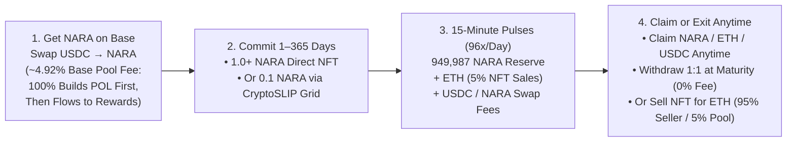

 

# NARA Protocol — Master Project Knowledge Base (V5 Canonical)

**Autonomous On-Chain Value & Resource Redistribution Engine on Base (`chainId: 8453`)**

> **Synchronization Stamp:** Verified against Base Mainnet (`chainId: 8453`) — Deployment Checkpoint Block `53,422,831` (synchronized through Block `53,443,166`, `2026-11-03`).

---

## ⚡ 1. What Is NARA? (15-Second Summary)

**NARA is an autonomous on-chain value and resource redistribution engine on Base (`chainId: 8453`).**

* **Fixed Scarcity (`1,000,000 NARA`):** Only **`1,000,000 NARA`** will ever exist — zero owner, zero mint function, zero team/VC allocations, and **`99.9984%` (`999,984 NARA`)** is sealed directly inside verified protocol smart contracts.
* **15-Minute Epoch Pulses (`96x / Day`):** Every **15 minutes (`900s`)**, `NARAEpochEngineV5` distributes `NARA` from the **`949,987 NARA` reserve** plus protocol fees (`NARA`, `ETH`, and `USDC`) across active positions pro-rata by weight (`Your Weight ÷ Total Active Weight`).
* **1 to 365 Day Commitments (`1.00x` to `4.00x` Weight):** Commit **`1.0+ NARA`** directly into your own **Position NFT (`NARAP`)**, or commit **`0.1 NARA` per slot** in the shared 10-slot **CryptoSLIP `NARA Grid`**.
* **Two Ways to Exit Anytime:** Withdraw **100% of your committed `NARA` 1-for-1** (`0%` fee) as soon as your commitment timer ends, or sell your live Position NFT anytime for **`ETH`** on the built-in **`NARAPositionSaleV5`** marketplace (**`95%` to seller**, **`5%` royalty** routed to the 15-minute `ETH` reward pool).

> [!IMPORTANT]
> **No Promised Returns:** NARA is autonomous smart-contract software on Base — not a bank account, investment contract, or savings product. **We do not promise rewards, yield, APY, profit, or price support.** Every 15-minute distribution depends strictly on smart-contract rules and real on-chain activity, is never guaranteed, and **can be zero (`0`)**.

---

## 💎 2. Fixed Supply & On-Chain Custody (`1,000,000 NARA`)

`NARATokenV5` ([`0x91FB78A9F46B67f54BbD4489941d19666b2fAe0f`](https://basescan.org/token/0x91FB78A9F46B67f54BbD4489941d19666b2fAe0f)) was minted once at deployment (`1,000,000 NARA`) with **no owner and no mint capability**. It includes gasless `ERC-2612 permit`, `ERC-1363` transfer-and-call, `Multicall`, and bounded `ERC-3156` flash minting (`100,000 NARA` cap, `0.10%` / `10 bps` fee routed directly to `NARAEmissionReserveV5`).

| Allocation | Amount (`NARA`) | Share of Supply | On-Chain Custodian | Rule & Purpose |
| :--- | :--- | :--- | :--- | :--- |
| **15-Minute Emission Reserve** | **`949,987.0 NARA`** | **`94.9987%`** | [`NARAEmissionReserveV5`](https://basescan.org/address/0xf932178F24b0813C82093985F0Af6Db27Ae25930) | Permanently bound (`coreBound = true`, sealed) to `NARAEpochEngineV5` to fund 15-minute emission pulses |
| **Two-Way Range Liquidity** | **`49,997.0 NARA`** | **`4.9997%`** | [`NARATreasuryRangeManagerV5`](https://basescan.org/address/0xa72557fcBE56B3eC739dF3aF7b6b893B6Db4D288) | Active two-way range liquidity (`NARA -> USDC` upside rungs & `USDC -> NARA` dip buy-back rungs; `7-day` `NARA` withdrawal delay extendable to `1 year`) |
| **Initial Pool Seed** | **`3.0 NARA`** | **`0.0003%`** | [`Treasury Safe (2-of-3)`](https://basescan.org/address/0xe320C281c86079eA85f2Bc67864E873A61D551E3) | Paired with `300.0 USDC` in the Treasury Safe to seed the canonical Uniswap v4 pool at `$100.00 / NARA` (`3 NARA + 300 USDC`) |
| **Live Principal & E2E Verification** | **`13.0 NARA`** | **`0.0013%`** | [`NARAPrincipalLedgerV5`](https://basescan.org/address/0x7F866a9fbe41D54F0d9C35b6892fcf27Ea766DB2) & Verification Wallets | Committed in live Base Mainnet positions on `NARAPrincipalLedgerV5` (`Position #1` at `1.0 NARA` + live E2E positions) and verification float (`13.0 NARA` total) |
| **Total Fixed Supply** | **`1,000,000.0 NARA`** | **`100.0000%`** | [`NARATokenV5`](https://basescan.org/token/0x91FB78A9F46B67f54BbD4489941d19666b2fAe0f) | Immutable hard cap (`0` owner, `0` mint) |

---

## 🔄 3. Committing NARA, `0.1 NARA` Grid & `5%` NFT Market

### A. Commit `1` to `365 Days` (`1.00x` to `4.00x` Quadratic Weight)
Users commit `NARA` into segregated `1:1` custody in [`NARAPrincipalLedgerV5`](https://basescan.org/address/0x7F866a9fbe41D54F0d9C35b6892fcf27Ea766DB2) for **`1 day` (`96` epochs)** up to **`365 days` (`35,040` epochs)**. Longer commitments receive up to **`4.00x` weight** via the on-chain `V4Quadratic` curve:

$$\text{Multiplier}(r) = 1 + 0.5r + 2.5r^2, \quad r = \frac{\text{durationEpochs}}{35040}$$

| Commitment Duration | Epochs (`900s` Each) | Weight Multiplier | Weight for `100 NARA` | Equivalent `1-Day` Principal |
| :--- | :--- | :--- | :--- | :--- |
| **1 Day** *(Minimum)* | `96` epochs | **`1.00x`** | `100` Weight | `100 NARA` |
| **30 Days** *(1 Month)* | `2,880` epochs | **`1.06x`** | `106` Weight | `106 NARA` |
| **90 Days** *(3 Months)* | `8,640` epochs | **`1.28x`** | `128` Weight | `128 NARA` |
| **180 Days** *(6 Months)* | `17,280` epochs | **`1.85x`** | `185` Weight | `185 NARA` |
| **365 Days** *(1 Year Max)* | `35,040` epochs | **`4.00x (Max)`** | **`400` Weight** | **`400 NARA` (4x Weight)** |

* **Activation Warm-Up:** New positions activate after **`8 epochs` (`2 hours`)**.
* **Equal-Footing Launch Mode:** Paid VRF rarity rolls and 5-input fusion in [`NARAForgeV5`](https://basescan.org/address/0x84225aBaBbE7433c736925f9c0ba6f6CcB51551a) are paused at launch (`commitsPaused = true`), so every participant enters as a standard `1X` Common position with zero roll or fusion fees.

### B. CryptoSLIP Companion (`0.1 NARA` Grid & Payment Slips)
Because a direct Position NFT requires `1.0 NARA` minimum, the [**CryptoSLIP App**](https://cryptoslip-g29s.4everland.app/?v=cs-1793645949345) lets anyone participate starting from **`0.1 NARA`**:
* **10-Slot `0.1 NARA` `NARA Grid`:** Commit `0.1 NARA` per slot into the shared 10-slot **NARA Grid** (`10 × 0.1 NARA = 1.0 NARA` Position NFT), where each slot receives **`10%`** of the position's 15-minute rewards and principal.
* **Instant `NARA` Payment Slips:** Send, receive, or split fractional `NARA` off-DEX via shareable links or QR codes (`0%` transfer tax).
* **Full CryptoSLIP Guide & 25-Question Legal FAQ:** Have questions about how CryptoSLIP V3.2 works, non-custodial security, or regulatory classification? Read [**CryptoSLIP Public Overview & Legal FAQ (`CRYPTOSLIP_PUBLIC_OVERVIEW_AND_LEGAL_FAQ.md`)**](CRYPTOSLIP_PUBLIC_OVERVIEW_AND_LEGAL_FAQ.md).

### C. Withdraw `1:1` at Maturity or Sell Your Position NFT Anytime (`5%` Royalty)
* **1-for-1 Principal Withdrawal (`0%` Fee) or Recharge:** Once your position's `maturity` epoch is reached, call `withdrawPrincipal(id, generation, recipient)` on `NARAPrincipalLedgerV5` to receive **100% of your committed `NARA` back 1-for-1**, or call `rechargeCommon` to roll your matured position into a fresh commitment generation.
* **Built-In `ETH` Position Marketplace ([`NARAPositionSaleV5`](https://basescan.org/address/0x04Ac83045d26259D46400Ce6beb9bBd0641df225)):** List your active `NARAP` Position NFT for native **`ETH`** anytime before maturity (up to 30-day listing duration). When bought:
  * **`95%` (`9,500 bps`)** of the `ETH` goes immediately to the **seller**.
  * **`5%` (`500 bps`)** `ETH` royalty fee routes directly into [`NARARewardIngressV5`](https://basescan.org/address/0x44130CC47b886D8488041F5eaE271477D1aFA909) for 15-minute `ETH` reward distributions to active positions.

---

## 🌊 4. Uniswap v4 Hook, Two-Phase Fees & Two-Way Range Manager

### A. Uniswap v4 Hook ([`NARALiquidityHookV5`](https://basescan.org/address/0x201fBD2839bEc513040024b37dAe97B401E96acC))
* **Zero ERC-20 Transfer Tax (`0%`):** Standard wallet-to-wallet `NARA` transfers and CryptoSLIP slip operations pay **`0%` tax**.
* **Base Pool Swap Fee (`4.9161%` Each Way):** Inside the canonical Uniswap v4 `USDC/NARA` pool (`Pool ID: 0x3bd8b60dc9eb37f00afa57585232e4018ae661b2dbd5318562183a67a07ac758`), normal swaps pay **`4.63%` (`463 bps`)** Hook fee + **`0.30%` (`3000 pips`)** LP fee = **`4.9161%` total each way**.
* **Same-Block Anti-Bot Tiers:** Cumulative volume within the same 2-second Base block steps through progressive tiers (`5% / 8% / 12% / 20%` on buys; `5% / 7% / 10% / 15%` up to `20%` hard cap on sells) and resets on the next block.

### B. Two-Phase Hook Fee Routing (`100% POL` → `Engine Rewards`)
1. **Phase 1 (Launch — Build Permanent Pool Liquidity):** At launch, **100% of Hook swap fees** route to [`NARAFeeVaultV5`](https://basescan.org/address/0xe63b4BaAF873FC57859bfe13e0e8cFccAaB6AddE) (`holderFeeBps = 0`) to compound permanent Protocol-Owned Liquidity ([`NARAPOLPositionV5`](https://basescan.org/address/0x01EF9de9f4e9197F2A3944b5B34A90eA2f558b64)).
2. **Phase 2 (Once Liquidity Is Built — Direct 15-Minute Rewards):** Once pool depth is established, the `Treasury Safe` shifts the Hook fee split (up to `100%`, governed by a 7-day delay) via [`NARAFeeIngressBindingV5`](https://basescan.org/address/0x8f41d6427B25525fB863203c78FF9050B3bd0DBC) into [`NARARewardIngressV5`](https://basescan.org/address/0x44130CC47b886D8488041F5eaE271477D1aFA909) → [`NARARewardLedgerV5`](https://basescan.org/address/0xC72671D9438388638547444524F6542b650C9264), streaming swap fees (`USDC` and `NARA`) to committed `NARA` positions every 15 minutes.

### C. Two-Way Range Liquidity Manager ([`NARATreasuryRangeManagerV5`](https://basescan.org/address/0xa72557fcBE56B3eC739dF3aF7b6b893B6Db4D288))
Holds **`49,997.0 NARA` (`4.9997%`)** for **two-way concentrated range liquidity**:
* **Upside Rungs (`NARA -> USDC`):** Supplies `NARA` across price bands above spot so the pool deepens and collects `USDC` as price rises.
* **Dip Buy-Back Rungs (`USDC -> NARA`):** Uses collected `USDC` across lower price bands to buy `NARA` back on pullbacks.
* **Surplus & Fee Recycling Toward Committed Positions:** Net trading surplus and LP proceeds generated by the Range Manager — alongside swap fees — may be used to acquire `NARA` from the market and send it into [`NARAEmissionReserveV5`](https://basescan.org/address/0xf932178F24b0813C82093985F0Af6Db27Ae25930), routed into the 15-minute reward pool, or deployed into higher-impact ecosystem mechanisms as we build — so that captured swap taxes and range liquidity proceeds are used in one way or another to benefit committed `NARA` positions *(discretionary, activity-dependent, and never promised or guaranteed)*.
* **Custody Safeguards:** Enforces `0-delay` `USDC` settlement to `Treasury Safe`, `0-delay` `NARA` replenishment to `NARAEmissionReserveV5`, and a mandatory **`7-day` `NARA` withdrawal delay** at launch so live operation can be verified, extendable up to **`1 year` (`365 days`)** once verified.

---

## 🔗 5. Verified Base Mainnet V5 Contract Registry (`34 Contracts` + `3 Safes`)

### Immutable Base & 2-of-3 Multisig Safes
| Role / Contract | Base Mainnet Address | Notes |
| :--- | :--- | :--- |
| **`NARATokenV5`** | [`0x91FB78A9F46B67f54BbD4489941d19666b2fAe0f`](https://basescan.org/token/0x91FB78A9F46B67f54BbD4489941d19666b2fAe0f) | Fixed `1,000,000 NARA` supply, `0` owner, `0` mint (`0.10%` flash-loan fee sink = `NARAEmissionReserveV5`) |
| **`USDC` (Base Native)** | [`0x833589fCD6eDb6E08f4c7C32D4f71b54bdA02913`](https://basescan.org/token/0x833589fCD6eDb6E08f4c7C32D4f71b54bdA02913) | Canonical pool `currency0` quote asset |
| **`NARAEmissionReserveV5`** | [`0xf932178F24b0813C82093985F0Af6Db27Ae25930`](https://basescan.org/address/0xf932178F24b0813C82093985F0Af6Db27Ae25930) | Holds **`949,987.0 NARA`** (`coreBound = true`, permanently sealed to `NARAEpochEngineV5`) |
| **`Treasury Safe (2-of-3)`** | [`0xe320C281c86079eA85f2Bc67864E873A61D551E3`](https://basescan.org/address/0xe320C281c86079eA85f2Bc67864E873A61D551E3) | Protocol Governor & Guardian Safe (`2-of-3`) |
| **`OA-3 VRF Safe (2-of-3)`** | [`0x9d415e070AF8e93890dcCaE27755C66E3A313f0F`](https://basescan.org/address/0x9d415e070AF8e93890dcCaE27755C66E3A313f0F) | Independent `2-of-3` Safe for VRF adapter governance |
| **`C1 Presentation Safe (2-of-3)`** | [`0x0939BE9a5359764C2334a70A13eC567C7e38E017`](https://basescan.org/address/0x0939BE9a5359764C2334a70A13eC567C7e38E017) | Independent `2-of-3` Safe for NFT metadata/renderer governance |

### V5 Core Engine, Ledgers, NFT & Lenses (Deployed & Sealed)
| Contract | Base Mainnet Address | Purpose |
| :--- | :--- | :--- |
| **`NARAEpochEngineV5`** | [`0xd93FbEbFb33FAc9288125074625D4750573B1a53`](https://basescan.org/address/0xd93FbEbFb33FAc9288125074625D4750573B1a53) | 15-minute (`900s`) epoch settlement engine (`activated = true`) |
| **`NARAPrincipalLedgerV5`** | [`0x7F866a9fbe41D54F0d9C35b6892fcf27Ea766DB2`](https://basescan.org/address/0x7F866a9fbe41D54F0d9C35b6892fcf27Ea766DB2) | Segregated `1:1` user principal custody (`1 day` to `365 days`, zero admin drain) |
| **`NARARewardLedgerV5`** | [`0xC72671D9438388638547444524F6542b650C9264`](https://basescan.org/address/0xC72671D9438388638547444524F6542b650C9264) | Multi-asset (`NARA`, `ETH`, `USDC`) epoch reward accounting & claim vault |
| **`NARAPositionNFTV5`** | [`0x8C5F088D9d09dBB90aB6F3aaA049a8FD5D5FfFDA`](https://basescan.org/address/0x8C5F088D9d09dBB90aB6F3aaA049a8FD5D5FfFDA) | Liquid ERC-721 Position NFTs (`NARAP`) |
| **`NARARewardIngressV5`** | [`0x44130CC47b886D8488041F5eaE271477D1aFA909`](https://basescan.org/address/0x44130CC47b886D8488041F5eaE271477D1aFA909) | External `NARA` / `ETH` / `USDC` reward ingress router (`forward()` to `NARARewardLedgerV5`) |
| **`NARAEmissionModelV5`** | [`0xd26b3c23d677b2DE82722DB5e687744600d4A231`](https://basescan.org/address/0xd26b3c23d677b2DE82722DB5e687744600d4A231) | Stateless adaptive emission math model |
| **`NARAForgeV5`** | [`0x84225aBaBbE7433c736925f9c0ba6f6CcB51551a`](https://basescan.org/address/0x84225aBaBbE7433c736925f9c0ba6f6CcB51551a) | Lifecycle module (`commitsPaused = true` at launch; equal-footing `1X` mode) |
| **`NARAPositionCardV5`** | [`0x12B9F23C24a4A0F29cA66F79183ed4C3f07588F5`](https://basescan.org/address/0x12B9F23C24a4A0F29cA66F79183ed4C3f07588F5) | On-chain SVG card composer |
| **`NARAPositionRendererV5`** | [`0x5Fd79Fc807B0e3d1e04A818f304526F8954dbd24`](https://basescan.org/address/0x5Fd79Fc807B0e3d1e04A818f304526F8954dbd24) | ERC-721 metadata & SVG renderer |
| **`NARAFrameArtV5`** | [`0x2fe91CF40a1392b4149fc8ffffE22393d1fdFF23`](https://basescan.org/address/0x2fe91CF40a1392b4149fc8ffffE22393d1fdFF23) | On-chain mineral frame art store |
| **`NARARewardLensV5`** | [`0x4a5e7ec22d34885334deA050679f01a030a635Bf`](https://basescan.org/address/0x4a5e7ec22d34885334deA050679f01a030a635Bf) | Read-only reward query lens |
| **`NARAPositionLensV5`** | [`0x4887303fba121a7B99A964B4e57903e688aD1e45`](https://basescan.org/address/0x4887303fba121a7B99A964B4e57903e688aD1e45) | Read-only position query lens |
| **`NARAPrincipalLensV5`** | [`0xDCf87e4ba3706E3ac94b10A7BD157Baf64fFE6d0`](https://basescan.org/address/0xDCf87e4ba3706E3ac94b10A7BD157Baf64fFE6d0) | Read-only principal query lens |
| **`NARAPositionStatsReaderV5`** | [`0x7aD6Eab12F6DBa36810c6c94C259d07fA3E043c2`](https://basescan.org/address/0x7aD6Eab12F6DBa36810c6c94C259d07fA3E043c2) | Position stats helper |
| **`NARAPrincipalAdmissionV5`** | [`0x319f02F0a1cb2b18DA0C268231ECa3C9dA252ca0`](https://basescan.org/address/0x319f02F0a1cb2b18DA0C268231ECa3C9dA252ca0) | Principal admission helper |
| **`NARALifecycleLedgerV5`** | [`0x3F2987fE6A5418F4DB415Fd08E0f7567F010f043`](https://basescan.org/address/0x3F2987fE6A5418F4DB415Fd08E0f7567F010f043) | Lifecycle state ledger |
| **`NARARewardCreditLedgerV5`** | [`0x0B98eb99b8E78c216632fADa9ad6ECB4fCFbDf4B`](https://basescan.org/address/0x0B98eb99b8E78c216632fADa9ad6ECB4fCFbDf4B) | Generation credit ledger |
| **`NARAForgeQuoteV5`** | [`0x3fA5c60A9d7A2A1B09Ec40a20593D5Ad26022Bbb`](https://basescan.org/address/0x3fA5c60A9d7A2A1B09Ec40a20593D5Ad26022Bbb) | Forge quote lens |
| **`NARAEntropyAdapterV5`** | [`0x9fAf0606c62cA28d34d76e1710BF6E4f523fda5F`](https://basescan.org/address/0x9fAf0606c62cA28d34d76e1710BF6E4f523fda5F) | Chainlink VRF v2.5 adapter (dormant while Forge paused) |
| **`NARANullEntropyAdapterV5`** | [`0x13b06070790C0A4Ed7f90B635b18E3FEF8ADa8ef`](https://basescan.org/address/0x13b06070790C0A4Ed7f90B635b18E3FEF8ADa8ef) | Null entropy adapter (idle) |

### V5 Marketplace, Uniswap v4 Hook, Fee Vault, POL & Range Manager
| Contract | Base Mainnet Address | Purpose |
| :--- | :--- | :--- |
| **`NARAPositionSaleV5`** | [`0x04Ac83045d26259D46400Ce6beb9bBd0641df225`](https://basescan.org/address/0x04Ac83045d26259D46400Ce6beb9bBd0641df225) | Built-in `ETH` marketplace for active Position NFTs (**`5%` / `500 bps` fee** to `NARARewardIngressV5`, **`95%` to seller**, 30d max listing) |
| **`NARASaleCreditLensV5`** | [`0x26b481f1545D9912D39693D7F8E589F82835e03d`](https://basescan.org/address/0x26b481f1545D9912D39693D7F8E589F82835e03d) | Sale credit verification lens (child of `NARAPositionSaleV5`) |
| **`NARALiquidityHookV5`** | [`0x201fBD2839bEc513040024b37dAe97B401E96acC`](https://basescan.org/address/0x201fBD2839bEc513040024b37dAe97B401E96acC) | Uniswap v4 Hook (`4.63%` base fee both ways + same-block tiers up to `20%`) |
| **`NARAHookFeeCalculatorV5`** | [`0x989aE21D79D9750A6528F1FCc4c2b331BF2D59d4`](https://basescan.org/address/0x989aE21D79D9750A6528F1FCc4c2b331BF2D59d4) | Hook fee tier calculator |
| **`Canonical Pool ID`** | `0x3bd8b60dc9eb37f00afa57585232e4018ae661b2dbd5318562183a67a07ac758` | Uniswap v4 `USDC/NARA` pool (`fee = 3000`, `tickSpacing = 60`) |
| **`NARAFeeVaultV5`** | [`0xe63b4BaAF873FC57859bfe13e0e8cFccAaB6AddE`](https://basescan.org/address/0xe63b4BaAF873FC57859bfe13e0e8cFccAaB6AddE) | Swap fee vault (`100%` POL at launch, shifts to Engine rewards once liquidity is built) |
| **`NARAFeeIngressBindingV5`** | [`0x8f41d6427B25525fB863203c78FF9050B3bd0DBC`](https://basescan.org/address/0x8f41d6427B25525fB863203c78FF9050B3bd0DBC) | FeeVault to `NARARewardIngressV5` binding |
| **`NARAPoolOracleV5`** | [`0xA2151333BDD77DF2E058f9cE274F63D2e48A5553`](https://basescan.org/address/0xA2151333BDD77DF2E058f9cE274F63D2e48A5553) | Observation oracle for Uniswap v4 pool |
| **`NARAPOLPositionV5`** | [`0x01EF9de9f4e9197F2A3944b5B34A90eA2f558b64`](https://basescan.org/address/0x01EF9de9f4e9197F2A3944b5B34A90eA2f558b64) | Protocol-Owned Liquidity position manager |
| **`NARALiquiditySizerV5`** | [`0x46B486a300190df823C5f1E4D04c100813fB0843`](https://basescan.org/address/0x46B486a300190df823C5f1E4D04c100813fB0843) | POL liquidity sizing helper |
| **`NARACapitalBudgetV5`** | [`0x6f5f586Bd4F14e47F432264D88Fe9A6A6A80552B`](https://basescan.org/address/0x6f5f586Bd4F14e47F432264D88Fe9A6A6A80552B) | POL compounding budget (`paused = true` at launch) |
| **`NARACapitalPolicyV5`** | [`0xC6b5471ADadcf66c2375EC8600bb7a3D85C73e45`](https://basescan.org/address/0xC6b5471ADadcf66c2375EC8600bb7a3D85C73e45) | Operator-only compounding policy |
| **`NARATreasuryRangeManagerV5`**| [`0xa72557fcBE56B3eC739dF3aF7b6b893B6Db4D288`](https://basescan.org/address/0xa72557fcBE56B3eC739dF3aF7b6b893B6Db4D288) | Holds **`49,997.0 NARA`** for two-way range liquidity (`NARA -> USDC` sell rungs & `USDC -> NARA` buy-back rungs; `7-day` `NARA` withdrawal delay extendable to `1 year`) |

---

## 🛡️ 6. Security Architecture & Multisig Governance

* **Segregated `1:1` User Principal (`NARAPrincipalLedgerV5`):** User-committed `NARA` is held separately from reward reserves and fee vaults, with **zero admin sweep, rescue, or upgrade functions**.
* **Sealed Core Wiring (`coreBound = true`):** `NARAEmissionReserveV5`, `NARAEpochEngineV5`, `NARAPrincipalLedgerV5`, `NARARewardLedgerV5`, `NARAPositionNFTV5`, and `NARARewardIngressV5` have permanently sealed core bindings on-chain.
* **Three Independent `2-of-3` Gnosis Safes:**
  * **Treasury Safe (`0xe320...51E3`):** Bounded protocol parameter & liquidity governance (subject to `7-day` delays on fee/liquidity withdrawals).
  * **OA-3 VRF Safe (`0x9d41...3f0F`):** Isolated VRF entropy adapter governance.
  * **C1 Presentation Safe (`0x0939...E017`):** Isolated NFT renderer/presentation governance (cannot touch user principal or rewards).

---

## 🌐 7. Official Links & Brand Assets

* **CryptoSLIP App (Buy / Commit / Grid / Slips):** [cryptoslip-g29s.4everland.app/?v=cs-1793645949345](https://cryptoslip-g29s.4everland.app/?v=cs-1793645949345) · [Public Overview & Legal FAQ](CRYPTOSLIP_PUBLIC_OVERVIEW_AND_LEGAL_FAQ.md)
* **Website:** [naraprotocol.io](https://naraprotocol.io)
* **X (Twitter):** [@NARA_protocol](https://x.com/NARA_protocol) · **Telegram:** [@naraprotocol](https://t.me/naraprotocol)
* **Official Brand Assets:** [Icon `256×256`](https://naraprotocol.io/nara_token_256.png) · [Icon `512×512`](https://naraprotocol.io/nara_token_512.png) · [Token `128×128`](https://naraprotocol.io/nara_token_128.png) · [Banner `1500×500`](https://naraprotocol.io/nara_dex_banner_1500x500.jpg)
